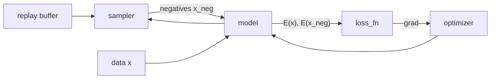

# Architecture

TorchEBM is organised around a small set of base classes (`BaseModel`,
`BaseSampler`, `BaseLoss`, `BaseIntegrator`, `BaseInterpolant`,
`BaseCoupling`). Everything else is composition in the training loop: a
coupling and an interpolant build the regression target, a loss compares
model outputs, a sampler drives the model through an integrator. The
user-facing statement of this design is
[Design and Scope](../concepts/design.md); this page is the contributor view.

## Package layout

The tree below is generated from the installed package at build time (comments
come from `docs/hooks/gen_diagrams.py`; new subpackages appear automatically):

<!-- torchebm:tree packages -->

Mirror this layout under `tests/` when adding tests.

## Core abstractions

One contract per axis. The table is generated at build time from the root base
classes exported by `torchebm.core` and the first line of their docstrings, so
it always matches the code:

<!-- torchebm:table contracts -->

The current composition map and export counts, generated from the installed
package at build time (see `docs/hooks/gen_diagrams.py`; per-family class
trees render the same way on the Concepts pages):

<!-- torchebm:diagram components -->

String registries (`get_integrator`, `get_coupling`, `get_interpolant`) make
each axis addressable by name; `resolve_*` helpers validate instances against
the family a consumer requires. Every component exported through
`torchebm.*.__init__` is auto-discovered by the benchmark suite (see
[Performance and Benchmarking](performance.md)).

## How the pieces compose

Training is the standard PyTorch loop: the model is called on inputs, a
loss function compares its outputs with targets, the optimizer steps. Losses
never hold the model; samplers take it as an argument of the call,
`sampler(model, x, n_steps=...)`, the `torchdiffeq` form. Two patterns cover
the library.

### Sampler-free (score, flow, EqM, EM warm-up)

The loop builds the target from data with a coupling and an interpolant:
couple the batch, draw \(t\), interpolate, call the model, regress.

```python
x0, x1 = coupling(torch.randn_like(x1), x1)
x_t, u_t = path(x0, x1, t)
loss = loss_fn(model(x_t, t), u_t)
```

Samplers only appear at generation time.

### Sampler-based (CD family, EM joint phase)

Contrastive divergence draws negatives from the current model every step,
from a replay buffer for persistent chains, and the loss compares the
energies of data and negatives:



`BaseTrainer.compute_loss` implements exactly this step given a `sampler`
and a `buffer`; other objectives override it.

### Generation (all objectives)

A sampler drives the trained model through an integrator. MCMC samplers
consume a score: an energy model is differentiated on the fly, a
`prediction_type="score"` model passes through, an `("energy", "score")`
pair is indexed. `FlowSampler` integrates a velocity, score or noise
prediction as an ODE or SDE on a uniform or custom time grid. Each piece can
be swapped (e.g. `integrator="heun"` for `"rk4"`) without changing the
others.

## Time conditioning

Not all objectives condition the model on \( t \):

- **EquilibriumMatching**: time-invariant; the model is called as
  `model(x_t)` in training and declares no `prediction_type`, so every
  sampler consumes the raw field: `FlowSampler` integrates it as the velocity
  and the gradient samplers apply \( x \leftarrow x + \eta f(x) \) to it.
- **FlowSampler with velocity/score models**: time-conditional; the field is
  \( v(x, t) \) and the sampler feeds \( t \) every step.
- **EnergyMatching**: the potential \(V(x)\) is time-independent; time lives
  in the temperature schedule of the generation sweep.

See `examples/20-training` for the reference loops.
