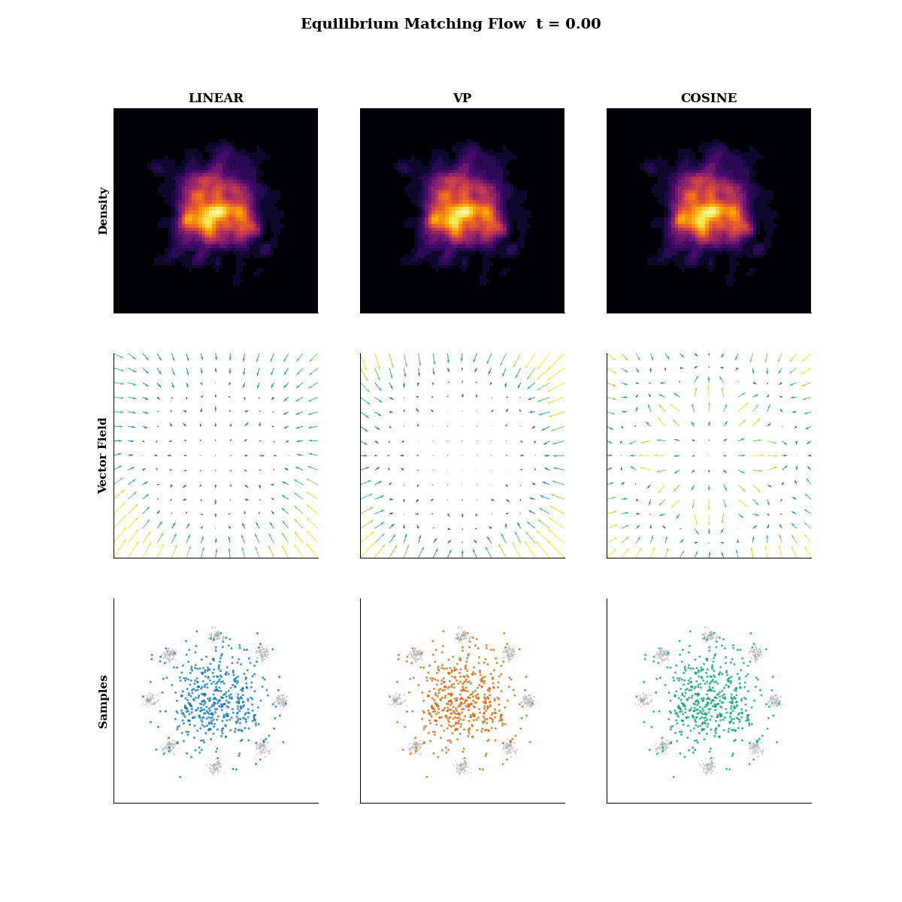
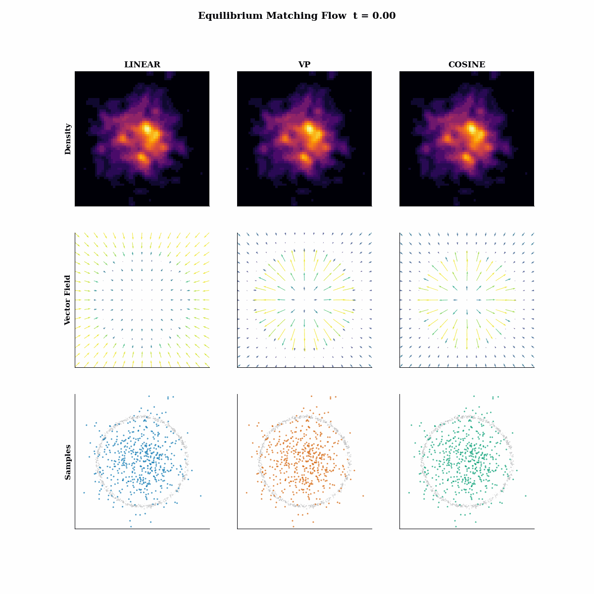

<style>
  .md-content h1:first-child { display: none; }
</style>

<div class="home-top">
  <svg viewBox="0 0 100 100" fill="none" xmlns="http://www.w3.org/2000/svg" class="home-nabla" aria-hidden="true">
    <polygon points="27.9,26.9 18.8,26.9 54.6,89.0 95.0,19.0 90.4,11.1 54.6,73.1" fill="#4DE8A0" stroke="#0a2818" stroke-width="1" stroke-linejoin="bevel"/>
    <polygon points="72.1,26.9 76.7,19.0 5.0,19.0 45.4,89.0 54.6,89.0 18.8,26.9" fill="#C7FF00" stroke="#0a2818" stroke-width="1" stroke-linejoin="bevel"/>
    <polygon points="50.0,65.1 54.6,73.1 90.4,11.0 9.6,11.1 5.0,19.0 76.7,19.0" fill="#1A7848" stroke="#0a2818" stroke-width="1" stroke-linejoin="bevel"/>
  </svg>

  <div class="home-title">
    <span class="home-torch">Torch</span><span class="home-ebm">EBM</span><span class="home-berry" aria-hidden="true">&#127827;</span>
  </div>

  <p class="home-tagline">
    TorchEBM: Simulation-free, GPU-first generative modeling in PyTorch<br>Composable primitives for scalable, stable training of <b>EBMs</b>, <b>diffusion</b>, <b>flow matching</b>, and <b>equilibrium and energy matching</b>.
  </p>

  <div class="home-actions">
    <a href="getting_started/" class="md-button md-button--primary">
      Get Started
    </a>
    <a href="https://github.com/soran-ghaderi/torchebm" class="md-button home-star-btn" target="_blank" rel="noopener">
      <svg xmlns="http://www.w3.org/2000/svg" viewBox="0 0 24 24" width="18" height="18" fill="currentColor" style="vertical-align: -3px; margin-right: 4px;"><path d="M12 .587l3.668 7.568L24 9.306l-6 5.848 1.416 8.259L12 19.446l-7.416 3.967L6 15.154 0 9.306l8.332-1.151z"/></svg>
      Star on GitHub
      
    </a>
  </div>
    <style>
    .md-content h1:first-child { display: none; }
    .home-top {
      text-align: center;
      padding: 0 0 20px;
      margin-bottom: 20px;
    }
    .home-nabla {
      display: block;
      margin: 0 auto 20px;
      width: 220px;
      height: 220px;
      max-width: 60vw;
    }
    .home-title {
      font-size: 3.2em;
      font-weight: 700;
      font-family: Raleway, sans-serif;
      letter-spacing: 0.5px;
      line-height: 1.1;
      margin-bottom: 16px;
    }
    .home-torch {
      background: linear-gradient(90deg, #C7FF00, #C7FF4C);
      -webkit-background-clip: text;
      -webkit-text-fill-color: transparent;
      background-clip: text;
      text-shadow: none;
      filter: drop-shadow(0 0 1px #000) drop-shadow(0 0 1px #000);
    }
    .home-ebm {
      background: linear-gradient(90deg, #00c6ff, #0072ff);
      -webkit-background-clip: text;
      -webkit-text-fill-color: transparent;
      background-clip: text;
      text-shadow: none;
      filter: drop-shadow(0 0 1px #000) drop-shadow(0 0 1px #000);
    }
    .home-berry {
      font-size: 0.5em;
      vertical-align: super;
      -webkit-text-fill-color: initial;
    }
    .home-tagline {
      font-size: 1.2em;
      max-width: 700px;
      margin: 0 auto 24px;
      line-height: 1.6;
      color: var(--md-default-fg-color--light);
    }
    .home-actions {
      display: flex;
      justify-content: center;
      gap: 12px;
      flex-wrap: wrap;
    }
    /* Badges */
    .home-badges {
      text-align: center;
      margin: 8px 0 0;
      line-height: 2;
    }
    .home-badges a { text-decoration: none; }
    .home-badges img { vertical-align: middle; margin: 2px 1px; }

    /* Demo animations */
    .home-demos {
      display: flex;
      justify-content: center;
      gap: 20px;
      flex-wrap: wrap;
      margin: 24px 0 8px;
    }
    .home-demo {
      text-align: center;
      margin: 0;
      flex: 1;
      min-width: 280px;
      max-width: 50%;
    }
    .home-demo img {
      width: 100%;
      border-radius: 8px;
      box-shadow: 0 4px 12px rgba(0,0,0,0.15);
    }
    .home-demo figcaption {
      margin-top: 10px;
      font-size: 0.9em;
      color: var(--md-default-fg-color--light);
    }
    .home-demo-caption {
      text-align: center;
      font-size: 0.85em;
      color: var(--md-default-fg-color--light);
      margin-top: 0;
    }

    /* Hero star button */
    .home-star-btn {
      position: relative;
    }
    .home-star-count {
      height: 20px;
      vertical-align: middle;
      margin-left: 6px;
      opacity: 0.7;
    }

    /* Post-quickstart star callout */
    .home-star-callout {
      text-align: center;
      margin: 32px auto;
      padding: 24px 32px;
      max-width: 600px;
      border-radius: 12px;
      border: 1px solid var(--md-default-fg-color--lightest);
      background: var(--md-code-bg-color);
    }
    .home-star-callout p {
      margin: 0 0 16px;
      font-size: 1.05em;
      line-height: 1.5;
    }
    .home-star-callout-btn {
      font-size: 0.95em;
    }

    /* Footer links */
    .home-footer {
      text-align: center;
      font-size: 0.9em;
      color: var(--md-default-fg-color--light);
      margin-top: 32px;
      padding-top: 16px;
      border-top: 1px solid var(--md-default-fg-color--lightest);
    }

    /* Built with TorchEBM */
    .home-papers {
      border-top: 1px solid var(--md-default-fg-color--lightest);
    }
    .md-typeset .home-paper {
      display: grid;
      grid-template-columns: 3.5em 1fr auto;
      align-items: baseline;
      gap: 16px;
      padding: 12px 10px;
      border-bottom: 1px solid var(--md-default-fg-color--lightest);
      color: inherit;
      transition: background-color 0.2s, box-shadow 0.2s;
    }
    .md-typeset a.home-paper:hover {
      color: inherit;
      background-color: var(--md-accent-fg-color--transparent);
      box-shadow: inset 3px 0 var(--md-accent-fg-color);
    }
    .home-paper-year {
      font-family: var(--md-code-font-family);
      font-size: 0.85em;
      color: var(--md-default-fg-color--light);
    }
    .home-paper-title {
      font-weight: 600;
    }
    .home-paper-title small {
      display: block;
      font-weight: 400;
      color: var(--md-default-fg-color--light);
    }
    .home-paper-tag {
      font-size: 0.75em;
      font-weight: 600;
      letter-spacing: 0.04em;
      text-transform: uppercase;
      white-space: nowrap;
      padding: 2px 10px;
      border-radius: 999px;
      border: 1px solid var(--md-typeset-a-color);
      color: var(--md-typeset-a-color);
    }

    @media (max-width: 600px) {
      .home-nabla { width: 160px; height: 160px; }
      .home-title { font-size: 2.4em; }
      .home-tagline { font-size: 1em; padding: 0 16px; }
      .home-demo { min-width: 100%; max-width: 100%; }
    }
  </style>

</div>


<div class="home-badges">
  <a href="https://pypi.org/project/torchebm/"></a>
  <a href="https://github.com/soran-ghaderi/torchebm/blob/master/LICENSE"></a>
  <a href="https://github.com/soran-ghaderi/torchebm"></a>
  <a href="https://deepwiki.com/soran-ghaderi/torchebm"></a>
  <a href="https://github.com/soran-ghaderi/torchebm/actions"></a>
  <a href="https://github.com/soran-ghaderi/torchebm/actions"></a>
  <a href="https://pepy.tech/project/torchebm"></a>
  <a href="https://pypi.org/project/torchebm/"></a>
</div>


---

## Overview

A PyTorch library of composable, GPU-first primitives for energy-based models,
diffusion, flow matching, and equilibrium and energy matching. Every method is a
composition of the same parts: models, paths, couplings, objectives, samplers
and integrators. See [Design and Scope](concepts/design.md).

---

## In Action

<div class="home-demos">
  <figure class="home-demo">
    
    <figcaption>Eight-gaussians distribution</figcaption>
  </figure>
  <figure class="home-demo">
    
    <figcaption>Circles distribution</figcaption>
  </figure>
</div>

<p class="home-demo-caption">Equilibrium matching with different interpolants transporting noise onto structured distributions.</p>

---

## Core Components

<!-- torchebm:cards components -->

---

## Quick Start

```bash
pip install torchebm
```

Train **EqM-XL/2** with
[equilibrium matching](https://arxiv.org/abs/2510.02300) on ImageNet 256
latents `x1` with labels `y` at times `t`:

```python
model = dit_xl_2(input_size=32, in_channels=4, num_classes=1000, time_invariant=True)
path, loss_fn = LinearInterpolant(), EquilibriumMatchingLoss()
sampler = NesterovSampler(step_size=0.0017, momentum=0.3, lookahead_only=True,
                          prediction_type="velocity")

x_t, u_t = path(torch.randn_like(x1), x1, t)
loss = loss_fn(model(x_t, y=y), u_t, t)
samples = sampler(model, torch.randn_like(x1), n_steps=249, model_kwargs={"y": y})
```

??? example "Full recipe as in the paper: VAE moments encoded once, EMA, guidance and decoding"

    ```python
    import torch
    from diffusers.models import AutoencoderKL
    from torch.optim.swa_utils import AveragedModel, get_ema_multi_avg_fn
    from torch.utils.data import DataLoader, TensorDataset
    from torchvision import datasets, transforms
    from torchebm.interpolants import LinearInterpolant
    from torchebm.losses import EquilibriumMatchingLoss
    from torchebm.models import ClassifierFreeGuidance, dit_xl_2
    from torchebm.samplers import NesterovSampler

    transform = transforms.Compose([
        transforms.Resize(256),
        transforms.CenterCrop(256),
        transforms.ToTensor(),
        transforms.Normalize([0.5, 0.5, 0.5], [0.5, 0.5, 0.5]),
    ])
    dataset = datasets.ImageFolder("imagenet/train", transform)
    vae = AutoencoderKL.from_pretrained("stabilityai/sd-vae-ft-ema").cuda()

    moments = torch.empty(len(dataset), 2, 8, 32, 32, dtype=torch.float16)
    with torch.no_grad():
        for i, (images, _) in enumerate(DataLoader(dataset, batch_size=256, num_workers=8)):
            for mirror, view in enumerate([images, images.flip(-1)]):
                latent = vae.encode(view.cuda()).latent_dist
                moments[256 * i : 256 * i + len(view), mirror] = torch.cat([latent.mean, latent.std], 1)
    labels = torch.tensor(dataset.targets)
    loader = DataLoader(TensorDataset(moments, labels), batch_size=256, shuffle=True, drop_last=True)

    model = dit_xl_2(
        input_size=32, in_channels=4, num_classes=1000, class_dropout_prob=0.1,
        time_invariant=True,
    ).cuda()
    optimizer = torch.optim.AdamW(model.parameters(), lr=1e-4, weight_decay=0)
    ema = AveragedModel(model, multi_avg_fn=get_ema_multi_avg_fn(0.9999))
    path, loss_fn = LinearInterpolant(), EquilibriumMatchingLoss()

    for epoch in range(1400):
        for batch, y in loader:
            mirror = torch.randint(2, (len(y),))
            mean, std = batch[torch.arange(len(y)), mirror].cuda().float().chunk(2, dim=1)
            x1, y = (mean + std * torch.randn_like(std)) * 0.18215, y.cuda()
            x0, t = torch.randn_like(x1), torch.rand(len(x1), device="cuda")
            x_t, u_t = path(x0, x1, t)
            loss = loss_fn(model(x_t, y=y), u_t, t)
            optimizer.zero_grad()
            loss.backward()
            optimizer.step()
            ema.update_parameters(model)

    guided = ClassifierFreeGuidance(
        ema.module.eval(), guidance_scale=1.5, null_condition=1000, guide_channels=3
    )
    sampler = NesterovSampler(
        step_size=0.0017, momentum=0.3, lookahead_only=True, prediction_type="velocity"
    )
    y = torch.randint(1000, (64,), device="cuda")
    noise = torch.randn(64, 4, 32, 32, device="cuda")
    latents = sampler(guided, noise, n_steps=249, model_kwargs={"y": y})
    with torch.no_grad():
        samples = vae.decode(latents / 0.18215).sample
    ```

More in the [concepts](concepts/) and [examples](examples/).

<div class="home-star-callout">
  <p>
    <strong>Enjoying TorchEBM?</strong> A GitHub star helps others discover the project and motivates continued development.
  </p>
  <a href="https://github.com/soran-ghaderi/torchebm" class="md-button md-button--primary home-star-callout-btn" target="_blank" rel="noopener">
    <svg xmlns="http://www.w3.org/2000/svg" viewBox="0 0 24 24" width="16" height="16" fill="currentColor" style="vertical-align: -2px; margin-right: 4px;"><path d="M12 .587l3.668 7.568L24 9.306l-6 5.848 1.416 8.259L12 19.446l-7.416 3.967L6 15.154 0 9.306l8.332-1.151z"/></svg>
    Star on GitHub
  </a>
</div>

---

## Built with TorchEBM

<div class="home-papers">
  <div class="home-paper">
    <span class="home-paper-year">2026</span>
    <span class="home-paper-title">Mixed-Field Matching</span>
    <span class="home-paper-tag">Preprint soon</span>
  </div>
</div>

---

## Citation

If TorchEBM is useful in your research, please cite it:

```bibtex
@misc{ghaderi2024torchebm,
  author       = {Ghaderi, Soran},
  title        = {{TorchEBM}: A Composable {PyTorch} Library for Energy-Based and Transport-Based Generative Modeling},
  year         = {2024},
  howpublished = {\url{https://github.com/soran-ghaderi/torchebm}},
}
```

<p class="home-footer">
  MIT License &middot;
  <a href="https://github.com/soran-ghaderi/torchebm/issues">Issues</a> &middot;
  <a href="developer_guide/">Contributing</a> &middot;
  <a href="https://github.com/soran-ghaderi/torchebm">GitHub</a>
</p>
